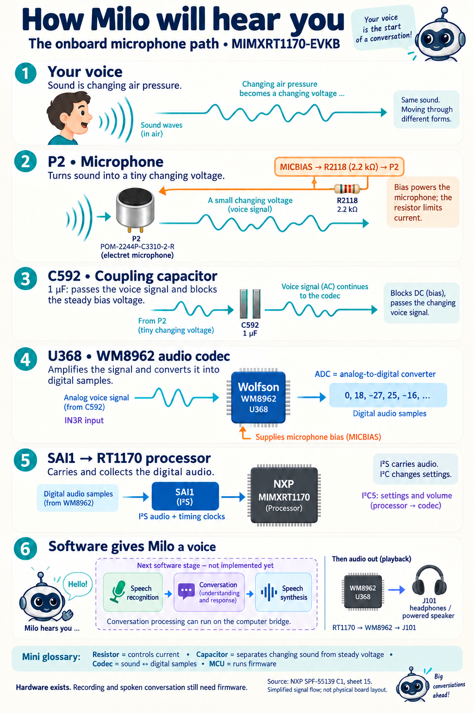

# How Milo will hear you

Read the picture from top to bottom. It shows the analog P2 microphone path,
not the physical placement of parts on the PCB.

1. Your voice creates changes in air pressure.
2. P2 turns those pressure changes into a tiny electrical signal. The codec's
   MICBIAS output supplies its operating power through R2118 (2.2 kilohms).
3. C592 (1 microfarad) passes the changing voice signal while blocking the
   steady bias voltage, into the codec's IN3R input.
4. U368, the Wolfson WM8962 codec, amplifies and digitizes the signal. Its ADC
   converts a continuously changing voltage into a sequence of numbers.
5. SAI1 carries those audio samples to the RT1170 processor. I2S is the audio
   connection; I2C5 is the separate connection used to configure the codec.
6. Future software will turn speech into text, generate a reply, and turn that
   reply into audio. Playback travels through the WM8962 to J101 headphones
   or a powered speaker. These conversation features are not implemented yet.

The drawing simplifies the circuit: clock sources, power decoupling, ground
connections, jumpers, and other codec components are omitted. It is not a
wiring guide. The separate digital microphone circuitry on sheet 16 is not
part of this analog signal path.

Source: NXP MIMXRT1170-EVKB schematic SPF-55139 revision C1, sheet 15 (SAI),
reviewed from the Adblocker project's hardware documentation.

Generated with the built-in image-generation tool and checked against the
schematic. Component illustrations are conceptual, not package photographs.
