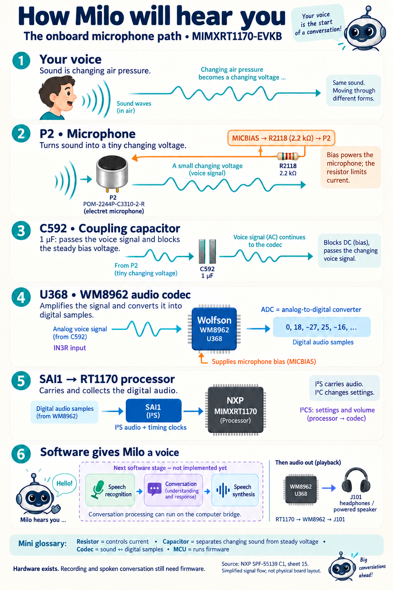

# Infographic Knowledge

## How Milo will hear you

This infographic follows your voice through the **MIMXRT1170-EVKB** board.
Read it from top to bottom. The drawings explain the signal flow, not the
physical positions of components on the board.

### 1. Your voice: moving air

Speaking creates small changes in air pressure. These sound waves reach the
microphone. At this stage, the information is carried by moving air.

### 2. P2: turning sound into electricity

**P2** is the onboard electret microphone. It turns sound into a tiny changing
voltage: an analog signal that follows your voice.

The microphone needs electrical power to operate. The audio codec supplies
**MICBIAS**, a steady bias voltage, through **R2118**, a **2.2 kΩ resistor**.
The resistor limits current and helps establish the microphone's operating
conditions. This is a power branch; the voice signal continues toward C592.

### 3. C592: separating voice from bias

**C592** is a **1 µF coupling capacitor**. The microphone signal includes both
steady bias and a changing voice signal. C592 blocks the steady DC component
while allowing the changing audio component through to the codec's **IN3R**
input. It does not recognize words or convert sound into digital data.

### 4. U368: converting the signal into numbers

**U368** is the **Wolfson WM8962 audio codec**. Its input circuitry can amplify
the small microphone signal. Its **ADC**, or analog-to-digital converter,
samples the voltage and represents it as a sequence of numbers.

These numbers describe sound. They are not yet words or sentences. The same
codec also supports the reverse process for playback: converting digital
audio into an analog output.

### 5. SAI1: carrying audio to the processor

The RT1170's **SAI1** audio interface receives digital audio from the codec
using **I²S** audio signaling and timing clocks. Firmware can collect those
samples into memory for processing.

A separate connection, **I²C5**, lets the processor configure the codec,
including input routing and gain. Remember the distinction:

- **I²S carries audio samples.**
- **I²C carries configuration commands.**

### 6. Software: understanding and answering

To make Milo conversational, we still need to implement:

1. Audio capture: collect microphone samples.
2. Speech recognition: turn recorded speech into text.
3. Conversation processing: produce a relevant response.
4. Speech synthesis: turn the response into spoken audio.
5. Playback: send audio from the RT1170 through the WM8962 to **J101**,
   the headphone output, connected to headphones or a powered speaker.

Conversation processing can run on the computer bridge. The microphone and
codec hardware already exist, but recording and spoken conversation are
**not implemented in the current Milo firmware**.

## Quick glossary

| Term | Beginner explanation |
|---|---|
| Resistor | A component that limits current and helps set electrical conditions. |
| Capacitor | Here, a component that passes changing audio while blocking steady bias. |
| Analog | A continuously changing electrical signal. |
| Digital sample | A number representing the signal at one instant. |
| ADC | Converts an analog signal into digital samples. |
| Codec | A chip that converts between analog and digital audio. |
| MCU | The microcontroller that runs Milo's firmware. |
| Bias | A steady electrical operating condition needed by the microphone. |

## Reading the diagram correctly

The picture focuses on the **P2 analog microphone path**. The board's separate
digital microphone circuitry is another path, described on schematic sheet 16.
Power decoupling, grounding, clock sources, jumpers, and other codec circuitry
are omitted for clarity. Use the schematic for wiring and electrical details.

**Source:** NXP MIMXRT1170-EVKB schematic **SPF-55139, revision C1, sheet 15
(SAI)**, inspected in the Adblocker project's hardware documentation.

**Image:** Created with the built-in image generator and reviewed against the
schematic. Component drawings are conceptual illustrations.
